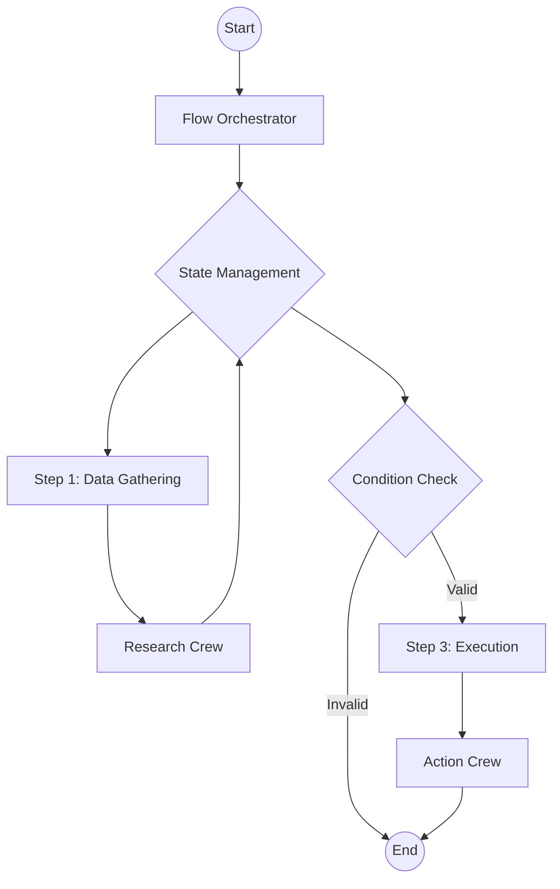

# Flow 优先的思维方式

在使用 CrewAI 构建生产级 AI 应用时，**我们建议从 Flow 开始**。

虽然可以单独运行 Crew 或 Agent，但将它们包装在 Flow 中能为构建健壮、可扩展的应用提供必要的结构。

## 为什么选择 Flow？

1. **状态管理**：Flow 提供了内置的方式来管理应用各个步骤之间的状态。这对于在 Crew 之间传递数据、维护上下文以及处理用户输入至关重要。
2. **控制力**：Flow 允许你定义精确的执行路径，包括循环、条件判断和分支逻辑。这对于处理边界情况、确保应用行为可预测至关重要。
3. **可观测性**：Flow 提供了清晰的结构，使追踪执行、调试问题和监控性能变得更容易。我们建议使用 [CrewAI Tracing](/zh-CN/observability/tracing) 获取详细洞察。只需运行 `crewai login` 即可启用免费的可观测性功能。

## 架构

一个典型的生产级 CrewAI 应用如下所示：



### 1. Flow 类
你的 `Flow` 类是应用的入口点。它定义状态模式（状态 schema）以及执行业务逻辑的方法。

```python
from crewai.flow.flow import Flow, listen, start
from pydantic import BaseModel

class AppState(BaseModel):
    user_input: str = ""
    research_results: str = ""
    final_report: str = ""

class ProductionFlow(Flow[AppState]):
    @start()
    def gather_input(self):
        # ... logic to get input ...
        pass

    @listen(gather_input)
    def run_research_crew(self):
        # ... trigger a Crew ...
        pass
```

### 2. 状态管理
使用 Pydantic 模型来定义你的状态。这样可以确保类型安全，并明确每一步可用的数据。

- **保持精简**：只存储需要在步骤之间持久化的数据。
- **使用结构化数据**：尽可能避免使用非结构化的字典。

### 3. 将 Crew 作为工作单元
将复杂的 task 委派给 Crew。每个 Crew 应专注于一个具体目标（例如"研究某个主题"、"撰写一篇博客文章"）。

- **不要过度设计 Crew**：保持其专注。
- **显式传递状态**：将所需数据从 Flow 状态显式传递到 Crew 的输入中。

```python
    @listen(gather_input)
    def run_research_crew(self):
        crew = ResearchCrew()
        result = crew.kickoff(inputs={"topic": self.state.user_input})
        self.state.research_results = result.raw
```

## 控制原语

利用 CrewAI 的控制原语为你的 Crew 增加健壮性和控制力。

### 1. Task 守护栏
使用 [Task 守护栏](/zh-CN/concepts/tasks#task-守护栏)在 task 输出被接受之前对其进行验证。这能确保你的 agent 产出高质量的结果。

```python
def validate_content(result: TaskOutput) -> Tuple[bool, Any]:
    if len(result.raw) < 100:
        return (False, "Content is too short. Please expand.")
    return (True, result.raw)

task = Task(
    ...,
    guardrail=validate_content
)
```

### 2. 结构化输出
在 task 之间或向应用传递数据时，务必使用结构化输出（`output_pydantic` 或 `output_json`）。这可以避免解析错误并确保类型安全。

```python
class ResearchResult(BaseModel):
    summary: str
    sources: List[str]

task = Task(
    ...,
    output_pydantic=ResearchResult
)
```

### 3. LLM 钩子
使用 [LLM 钩子](/zh-CN/learn/llm-hooks)在消息发送给 LLM 之前对其进行检查或修改，或对响应进行清洗。

```python
@before_llm_call
def log_request(context):
    print(f"Agent {context.agent.role} is calling the LLM...")
```

## 部署模式

在部署 Flow 时，请考虑以下几点：

### CrewAI Enterprise
部署 Flow 最简单的方式是使用 CrewAI Enterprise。它会为你处理基础设施、身份验证和监控。

查看[部署指南](https://docs-platform.crewai.com/platform/zh-CN/guides/deploy-to-amp)快速上手。

```bash
crewai deploy create
```

### 异步执行
对于长时间运行的 task，使用 `kickoff_async` 以避免阻塞你的 API。

### 持久化
使用 `@persist` 装饰器将 Flow 的状态保存到数据库。这样当进程崩溃或需要等待人工输入时，你可以恢复执行。

```python
@persist
class ProductionFlow(Flow[AppState]):
    # ...
```

默认情况下，当提供 `kickoff(inputs={"id": <uuid>})` 时，`@persist` 会恢复 flow 并延续相同的 `flow_uuid` 历史。若要将已持久化的 flow**分叉（fork）**到新的谱系——即从之前的运行中加载状态，但写入全新的 `state.id`——请传入 `restore_from_state_id`：

```python
flow.kickoff(restore_from_state_id="<previous-run-state-id>")
```

新的运行会获得全新的 `state.id`（自动生成，或在指定时使用 `inputs["id"]`），因此其 `@persist` 写入不会延续源运行的历史。与 `from_checkpoint` 同时使用会引发 `ValueError`；请只选择一种状态加载来源。

## 总结

- **从 Flow 开始。**-**定义清晰的状态。**-**用 Crew 处理复杂的 task。**-**通过 API 和持久化进行部署。**