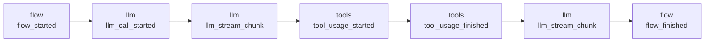

## 概述

流式输出让你的应用在任务仍在运行时就能接收执行更新。无需等待最终结果，你可以实时渲染 LLM token、工具活动、Flow 生命周期事件和对话消息。

CrewAI 提供两种流式接口：

| 接口 | 使用方 | 输出 |
|---------|---------|--------|
| 帧流式（Frame streaming） | Flow、直接 LLM 调用、对话轮次 | 有序的 `StreamFrame` 对象 |
| Crew 分块流式（chunk streaming） | 使用 `stream=True` 的 Crew | `CrewStreamingOutput` 分块 |

对于新的运行时集成、UI、终端应用、服务桥接和对话式界面，请使用帧流式。它为整个运行时提供统一且稳定的事件信封。

## StreamFrame

`StreamFrame` 是可流式运行时发出的通用对象：

```python
frame.id           # unique frame id
frame.seq          # execution-local order, when available
frame.type         # source event type, such as "llm_stream_chunk"
frame.channel      # "llm", "flow", "tools", "messages", "lifecycle", or "custom"
frame.namespace    # source/runtime namespace
frame.timestamp    # event timestamp
frame.parent_id    # parent event id, when available
frame.previous_id  # previous event id, when available
frame.data         # structured event payload
frame.event        # alias for frame.data
frame.content      # printable text for token-like frames, otherwise ""
```

对大多数消费者来说，重要的字段是：

| 字段 | 用途 |
|-------|------------|
| `channel` | 将帧路由到正确的 UI 区域 |
| `type` | 处理某个通道内的特定事件 |
| `content` | 打印类 token 的文本 |
| `event` | 读取结构化元数据，如工具名称或消息角色 |
| `seq` | 保持执行顺序 |

## 通道

帧按高层通道分组：

| 通道 | 包含内容 |
|---------|----------|
| `llm` | LLM 调用生命周期、文本分块和思考分块 |
| `flow` | Flow 生命周期、方法执行、路由、暂停和恢复事件 |
| `tools` | 工具使用的开始、结束和错误事件 |
| `messages` | 对话记录事件 |
| `lifecycle` | 不属于其他通道的运行时生命周期事件 |
| `custom` | 无法映射到内置通道的事件 |

流本身始终是一条有序的时间线。通道投影（channel projection）让消费者可以只关注该时间线的一部分。



## 流会话

帧流式返回一个流会话（stream session）：

```python
stream = flow.stream_events(inputs={"topic": "AI agents"})
```

该会话既是一个迭代器，也是最终结果的持有者：

```python
with stream:
    for frame in stream:
        print(frame.content, end="", flush=True)

result = stream.result
```

请先消费完流再读取 `stream.result`。过早读取结果会引发错误，因为运行时可能仍在产生帧。

## 通道投影

当你只需要某一类帧时，可使用通道投影：

```python
with flow.stream_events(inputs={"topic": "AI agents"}) as stream:
    for frame in stream.llm:
        print(frame.content, end="", flush=True)

result = stream.result
```

可用的投影：

| 投影 | 帧 |
|------------|--------|
| `stream.events` | 所有帧 |
| `stream.llm` | LLM 帧 |
| `stream.flow` | Flow 帧 |
| `stream.tools` | 工具帧 |
| `stream.messages` | 对话消息帧 |
| `stream.interleave([...])` | 按相对顺序排列的选定通道 |

## 入口点

请使用与你要流式处理的运行时相匹配的入口点：

| 运行时 | 流式入口点 |
|---------|----------------------|
| Flow | `flow.stream_events(...)` |
| 使用 `stream=True` 的 Flow | `flow.kickoff(...)` 返回流会话 |
| 异步 Flow | `flow.astream(...)`，或在 `stream=True` 时使用 `await flow.kickoff_async(...)` |
| 直接 LLM 调用 | `llm.stream_events(...)` |
| 对话式 Flow 轮次 | `flow.stream_turn(...)` |
| Crew | `Crew(..., stream=True).kickoff(...)` 返回 `CrewStreamingOutput` |

直接调用 `llm.call(...)` 仍然返回组装完成的最终 LLM 结果。当你想在 LLM 分块到达时逐个迭代处理，请使用 `llm.stream_events(...)`。

## 相关指南

- [消费流](/edge/zh-CN/learn/consuming-streams)
- [流式运行时契约](/edge/zh-CN/learn/streaming-runtime-contract)
- [流式 Flow 执行](/edge/zh-CN/learn/streaming-flow-execution)
- [流式 Crew 执行](/edge/zh-CN/learn/streaming-crew-execution)
