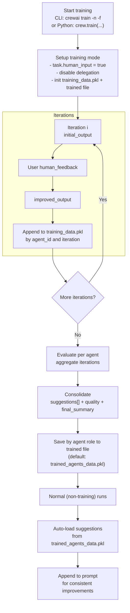

## 概述

CrewAI 的训练功能允许您使用命令行界面（CLI）来训练您的 AI agent。
通过运行命令 `crewai train -n <n_iterations>`，您可以指定训练过程的迭代次数。

在训练过程中，CrewAI 会结合人工反馈，利用多种技术优化 agent 的性能。
这有助于 agent 提升其理解、决策和解决问题的能力。

### 使用 CLI 训练您的 Crew

要使用训练功能，请按以下步骤操作：

1. 打开终端或命令提示符。
2. 进入您的 CrewAI 项目所在目录。
3. 运行以下命令：

```shell
crewai train -n <n_iterations> -f <filename.pkl>
```
<Tip>
  将 `<n_iterations>` 替换为所需的训练迭代次数，将 `<filename>` 替换为以 `.pkl` 结尾的合适文件名。
</Tip>

<Note>
  如果省略 `-f`，输出默认为当前工作目录下的 `trained_agents_data.pkl`。您可以传入绝对路径来控制文件的写入位置。
</Note>

### 以编程方式训练您的 Crew

要以编程方式训练您的 crew，请按以下步骤操作：

1. 定义训练的迭代次数。
2. 指定训练过程的输入参数。
3. 在 try-except 块中执行训练命令以处理潜在错误。

```python Code
n_iterations = 2
inputs = {"topic": "CrewAI Training"}
filename = "your_model.pkl"

try:
    YourCrewName_Crew().crew().train(
      n_iterations=n_iterations,
      inputs=inputs,
      filename=filename
    )

except Exception as e:
    raise Exception(f"An error occurred while training the crew: {e}")
```

## agent 如何使用训练后的数据

CrewAI 以两种方式使用训练产物：在训练期间纳入您的人工反馈，以及在训练结束后通过整合后的建议来指导 agent。

### 训练数据流



### 训练运行期间

- 在每次迭代中，系统会为每个 agent 记录：
  - `initial_output`：agent 的第一次回答
  - `human_feedback`：提示时您输入的内联反馈
  - `improved_output`：agent 收到反馈后的后续回答
- 这些数据存储在名为 `training_data.pkl` 的工作文件中，以 agent 的内部 ID 和迭代次数为键。
- 训练进行期间，agent 会自动将您之前的人工反馈附加到其提示词中，以在训练会话内的后续尝试中强制执行这些指令。
  训练是交互式的：task 会设置 `human_input = true`，因此在非交互式环境中运行时会阻塞等待用户输入。

### 训练完成后

- 当 `train(...)` 结束时，CrewAI 会按 agent 评估收集到的训练数据，并生成包含以下内容的整合结果：
  - `suggestions`：从您的反馈以及初始/改进输出之间的差异中提炼出的清晰、可执行的指令
  - `quality`：反映改进程度的 0–10 分评分
  - `final_summary`：面向未来 task 的分步行动项清单
- 这些整合结果会保存到您传给 `train(...)` 的文件名中（CLI 的默认值为 `trained_agents_data.pkl`）。条目以 agent 的 `role` 为键，以便跨会话应用。
- 在正常（非训练）执行期间，每个 agent 会自动加载其整合后的 `suggestions`，并将其作为强制指令附加到 task 提示词中。这让您无需更改 agent 定义即可获得一致的改进。

### 文件摘要

- `training_data.pkl`（临时文件，按会话生成）：
  - 结构：`agent_id -> { iteration_number: { initial_output, human_feedback, improved_output } }`
  - 用途：在训练期间捕获原始数据和人工反馈
  - 位置：保存在当前工作目录（CWD）中
- `trained_agents_data.pkl`（或您的自定义文件名）：
  - 结构：`agent_role -> { suggestions: string[], quality: number, final_summary: string }`
  - 用途：为未来的运行持久化整合后的指导信息
  - 位置：默认写入 CWD；使用 `-f` 设置自定义路径（包括绝对路径）

## 小型语言模型注意事项

<Warning>
  当使用较小的语言模型（参数量 ≤7B）进行训练数据评估时，请注意它们在生成结构化输出和遵循复杂指令方面可能会遇到困难。
</Warning>

### 小模型在训练评估中的局限性

<CardGroup cols={2}>
  <Card title="JSON 输出准确性" icon="triangle-exclamation">
    较小的模型通常难以生成结构化训练评估所需的有效 JSON 响应，从而导致解析错误和数据不完整。
  </Card>
  <Card title="评估质量" icon="chart-line">
    与较大模型相比，参数量低于 7B 的模型可能提供不够细致的评估，推理深度也有限。
  </Card>
  <Card title="指令遵循" icon="list-check">
    较小的模型可能无法完全遵循或考虑复杂的训练评估标准。
  </Card>
  <Card title="一致性" icon="rotate">
    使用较小模型时，多次训练迭代之间的评估可能缺乏一致性。
  </Card>
</CardGroup>

### 训练建议

<Tabs>
  <Tab title="最佳实践">
    为获得最佳训练质量和可靠的评估，我们强烈建议使用参数量至少为 7B 或更大的模型：

    ```python
    from crewai import Agent, Crew, Task, LLM

    # Recommended minimum for training evaluation
    llm = LLM(model="mistral/open-mistral-7b")

    # Better options for reliable training evaluation
    llm = LLM(model="anthropic/claude-3-sonnet-20240229-v1:0")
    llm = LLM(model="gpt-4o")

    # Use this LLM with your agents
    agent = Agent(
        role="Training Evaluator",
        goal="Provide accurate training feedback",
        llm=llm
    )
    ```

    <Tip>
      更强大的模型能凭借更好的推理能力提供更高质量的反馈，从而带来更有效的训练迭代。
    </Tip>
  </Tab>
  <Tab title="小模型使用">
    如果您必须使用较小的模型进行训练评估，请注意以下限制：

    ```python
    # Using a smaller model (expect some limitations)
    llm = LLM(model="huggingface/microsoft/Phi-3-mini-4k-instruct")
    ```

    <Warning>
      虽然 CrewAI 包含针对小模型的优化，但评估结果的可靠性和细致程度仍会较低，可能需要在训练期间进行更多人工干预。
    </Warning>
  </Tab>
</Tabs>

### 注意要点

- **正整数要求：**确保迭代次数（`n_iterations`）为正整数。如果不满足此条件，代码将抛出 `ValueError`。
- **文件名要求：**确保文件名以 `.pkl` 结尾。如果不满足此条件，代码将抛出 `ValueError`。
- **错误处理：**代码会处理子进程错误和意外异常，并向用户提供错误消息。
- 训练后的指导在提示词阶段应用；它不会修改您的 Python/YAML agent 配置。
- agent 会自动从当前工作目录中名为 `trained_agents_data.pkl` 的文件加载训练后的建议。如果您训练时使用了不同的文件名，可以通过 `Crew(trained_agents_file="my_custom_trained.pkl")` 传入该路径、设置 `CREWAI_TRAINED_AGENTS_FILE`，或使用 `crewai run -f my_custom_trained.pkl`。
- 调用 `crewai train` 时可以通过 `-f/--filename` 更改输出文件名。如果想保存到 CWD 之外，也支持绝对路径。

需要注意的是，训练过程可能需要一些时间，具体取决于 agent 的复杂程度，并且每次迭代都需要您提供反馈。

训练完成后，您的 agent 将具备增强的能力和知识，准备好应对复杂的 task，并提供更一致、更有价值的洞见。

请记得定期更新和重新训练您的 agent，以确保它们始终掌握该领域的最新信息和进展。
