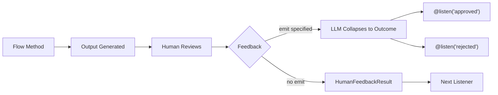

## 概述

<Note>
`@human_feedback` 装饰器需要 **CrewAI 版本 1.8.0 或更高版本**。使用此功能之前，请确保更新您的安装。
</Note>

`@human_feedback` 装饰器可直接在 CrewAI Flows 中启用人机交互 (HITL) 工作流程。它允许您暂停流程执行，将输出呈现给人们进行审查，收集他们的反馈，并可选择根据反馈结果路由到不同的听众。

这对于以下方面特别有价值：

- **质量保证**：在下游使用人工智能生成的内容之前对其进行审查
- **决策门**：让人类在自动化工作流程中做出关键决策
- **批准工作流程**：实施批准/拒绝/修改模式
- **交互式细化**：收集反馈以迭代改进输出



## 快速入门

以下是向流程添加人工反馈的最简单方法：

```python Code
from crewai.flow.flow import Flow, start, listen
from crewai.flow.human_feedback import human_feedback

class SimpleReviewFlow(Flow):
    @start()
    @human_feedback(message="Please review this content:")
    def generate_content(self):
        return "This is AI-generated content that needs review."

    @listen(generate_content)
    def process_feedback(self, result):
        print(f"Content: {result.output}")
        print(f"Human said: {result.feedback}")

flow = SimpleReviewFlow()
flow.kickoff()
```

当此流程运行时，它将：
1. 执行`generate_content`并返回字符串
2. 通过请求消息向用户显示输出
3. 等待用户输入反馈（或按 Enter 跳过）
4. 将`HumanFeedbackResult`对象传递给`process_feedback`

## @ human_feedback 装饰器

### 参数

| 范围 | 类型 | 必需的 | 描述 |
|-----------|------|----------|-------------|
| `message` | `str` | 是的 | 与方法输出一起向人类显示的消息 |
| `emit` | `Sequence[str]` | 不 | 可能的结果列表。反馈被折叠到其中之一，这会触发 `@listen` 装饰器 |
| `llm` | `str \| 基础LLM` | 当`emit`指定时 | LLM 用于解释反馈并映射到结果 |
| `default_outcome` | `str` | 不 | 如果没有提供反馈，则使用结果。必须位于`emit` |
| `metadata` | `dict` | 不 | 用于企业集成的附加数据 |
| `provider` | `HumanFeedbackProvider` | 不 | 用于异步/非阻塞反馈的自定义提供程序。请参阅[异步人工反馈](#async-human-feedback-non-blocking) |
| `learn` | `bool` | 不 | 启用 HITL 学习：从反馈中提取经验教训并预先审查未来的输出。默认`False`。请参阅[从反馈中学习](#learning-from-feedback) |
| `learn_source` | `str` | 不 | 存储课程并从中调用的内存`source`。默认`"hitl"` |
| `learn_strict` | `bool` | 不 | 当预复习或课程提炼失败时提高，而不是退缩。默认`False` |

### 基本用法（无路由）

当您不指定`emit`时，装饰器只是收集反馈并将`HumanFeedbackResult`传递给下一个侦听器：

```python Code
@start()
@human_feedback(message="What do you think of this analysis?")
def analyze_data(self):
    return "Analysis results: Revenue up 15%, costs down 8%"

@listen(analyze_data)
def handle_feedback(self, result):
    # result is a HumanFeedbackResult
    print(f"Analysis: {result.output}")
    print(f"Feedback: {result.feedback}")
```

### 带发射的路由

当你指定`emit`时，装饰器就变成了路由器。人类的自由形式反馈由LLM解释并分解为指定结果之一：

```python Code
from crewai.flow.flow import Flow, start, listen, or_
from crewai.flow.human_feedback import human_feedback

class ReviewFlow(Flow):
    @start()
    def generate_content(self):
        return "Draft blog post content here..."

    @human_feedback(
        message="Do you approve this content for publication?",
        emit=["approved", "rejected", "needs_revision"],
        llm="gpt-4o-mini",
        default_outcome="needs_revision",
    )
    @listen(or_("generate_content", "needs_revision"))
    def review_content(self):
        return "Draft blog post content here..."

    @listen("approved")
    def publish(self, result):
        print(f"Publishing! User said: {result.feedback}")

    @listen("rejected")
    def discard(self, result):
        print(f"Discarding. Reason: {result.feedback}")
```

当人们说“需要更多细节”之类的内容时，LLM会将其折叠为`"needs_revision"`，这会通过`or_()`再次触发`review_content` - 创建一个修订循环。循环继续，直到结果为`"approved"` 或`"rejected"`。

<Tip>
LLM 使用结构化输出（函数调用）（如果可用）来保证响应是您指定的结果之一。这使得路由可靠且可预测。
</Tip>

<Warning>
`@start()` 方法仅在流程开始时运行一次。如果需要修订循环，请将启动方法与审阅方法分开，并在审阅方法上使用`@listen(or_("trigger", "revision_outcome"))`以启用自循环。
</Warning>

## 人工反馈结果

`HumanFeedbackResult` 数据类包含有关人类反馈交互的所有信息：

```python Code
from crewai.flow.human_feedback import HumanFeedbackResult

@dataclass
class HumanFeedbackResult:
    output: Any              # The original method output shown to the human
    feedback: str            # The raw feedback text from the human
    outcome: str | None      # The collapsed outcome (if emit was specified)
    timestamp: datetime      # When the feedback was received
    method_name: str         # Name of the decorated method
    metadata: dict           # Any metadata passed to the decorator
```

### 在监听器中访问

当监听器被 `@human_feedback` 方法和 `emit` 触发时，它会收到 `HumanFeedbackResult`：

```python Code
@listen("approved")
def on_approval(self, result: HumanFeedbackResult):
    print(f"Original output: {result.output}")
    print(f"User feedback: {result.feedback}")
    print(f"Outcome: {result.outcome}")  # "approved"
    print(f"Received at: {result.timestamp}")
```

## 访问反馈历史记录

`Flow` 类提供了两个用于访问人类反馈的属性：

### 最后的人类反馈

返回最近的`HumanFeedbackResult`：

```python Code
@listen(some_method)
def check_feedback(self):
    if self.last_human_feedback:
        print(f"Last feedback: {self.last_human_feedback.feedback}")
```

### 人类反馈历史

流程中收集的所有 `HumanFeedbackResult` 对象的列表：

```python Code
@listen(final_step)
def summarize(self):
    print(f"Total feedback collected: {len(self.human_feedback_history)}")
    for i, fb in enumerate(self.human_feedback_history):
        print(f"{i+1}. {fb.method_name}: {fb.outcome or 'no routing'}")
```

<Warning>
每个`HumanFeedbackResult` 都附加到`human_feedback_history`，因此多个反馈步骤不会相互覆盖。使用此列表可以访问流程期间收集的所有反馈。
</Warning>

## 完整示例：内容审批工作流程

以下是使用修订循环实现内容审核和批准工作流程的完整示例：

<CodeGroup>

```python Code
from crewai.flow.flow import Flow, start, listen, or_
from crewai.flow.human_feedback import human_feedback, HumanFeedbackResult
from pydantic import BaseModel


class ContentState(BaseModel):
    draft: str = ""
    revision_count: int = 0
    status: str = "pending"


class ContentApprovalFlow(Flow[ContentState]):
    """A flow that generates content and loops until the human approves."""

    @start()
    def generate_draft(self):
        self.state.draft = "# AI Safety\n\nThis is a draft about AI Safety..."
        return self.state.draft

    @human_feedback(
        message="Please review this draft. Approve, reject, or describe what needs changing:",
        emit=["approved", "rejected", "needs_revision"],
        llm="gpt-4o-mini",
        default_outcome="needs_revision",
    )
    @listen(or_("generate_draft", "needs_revision"))
    def review_draft(self):
        self.state.revision_count += 1
        return f"{self.state.draft} (v{self.state.revision_count})"

    @listen("approved")
    def publish_content(self, result: HumanFeedbackResult):
        self.state.status = "published"
        print(f"Content approved and published! Reviewer said: {result.feedback}")
        return "published"

    @listen("rejected")
    def handle_rejection(self, result: HumanFeedbackResult):
        self.state.status = "rejected"
        print(f"Content rejected. Reason: {result.feedback}")
        return "rejected"


flow = ContentApprovalFlow()
result = flow.kickoff()
print(f"\nFlow completed. Status: {flow.state.status}, Reviews: {flow.state.revision_count}")
```

```text Output
==================================================
OUTPUT FOR REVIEW:
==================================================
# AI Safety

This is a draft about AI Safety... (v1)
==================================================

Please review this draft. Approve, reject, or describe what needs changing:
(Press Enter to skip, or type your feedback)

Your feedback: Needs more detail on alignment research

==================================================
OUTPUT FOR REVIEW:
==================================================
# AI Safety

This is a draft about AI Safety... (v2)
==================================================

Please review this draft. Approve, reject, or describe what needs changing:
(Press Enter to skip, or type your feedback)

Your feedback: Looks good, approved!

Content approved and published! Reviewer said: Looks good, approved!

Flow completed. Status: published, Reviews: 2
```

</CodeGroup>

关键模式是`@listen(or_("generate_draft", "needs_revision"))`——审查方法监听初始触发器和它自己的修订结果，创建一个重复的自循环，直到人们批准或拒绝。

## 与其他装饰器结合

`@human_feedback` 装饰器与`@start()`、`@listen()` 和`or_()` 一起使用。两种装饰器顺序都有效 - 框架在两个方向上传播属性 - 但推荐的模式是：

```python Code
# One-shot review at the start of a flow (no self-loop)
@start()
@human_feedback(message="Review this:", emit=["approved", "rejected"], llm="gpt-4o-mini")
def my_start_method(self):
    return "content"

# Linear review on a listener (no self-loop)
@listen(other_method)
@human_feedback(message="Review this too:", emit=["good", "bad"], llm="gpt-4o-mini")
def my_listener(self, data):
    return f"processed: {data}"

# Self-loop: review that can loop back for revisions
@human_feedback(message="Approve or revise?", emit=["approved", "revise"], llm="gpt-4o-mini")
@listen(or_("upstream_method", "revise"))
def review_with_loop(self):
    return "content for review"
```

### 自循环模式

要创建修订循环，审核方法必须使用`or_()`监听**上游触发器及其自己的修订结果：

```python Code
@start()
def generate(self):
    return "initial draft"

@human_feedback(
    message="Approve or request changes?",
    emit=["revise", "approved"],
    llm="gpt-4o-mini",
    default_outcome="approved",
)
@listen(or_("generate", "revise"))
def review(self):
    return "content"

@listen("approved")
def publish(self):
    return "published"
```

当结果是 `"revise"` 时，流程路由回 `review`（因为它通过 `or_()` 监听 `"revise"`）。当结果为`"approved"`时，流程继续至`publish`。这是有效的，因为流引擎使路由器免于“触发一次”规则，允许它们在每次循环迭代时重新执行。

### 链式路由器

由一个路由器的结果触发的侦听器本身可以是一个路由器：

```python Code
@start()
def generate(self):
    return "draft content"

@human_feedback(message="First review:", emit=["approved", "rejected"], llm="gpt-4o-mini")
@listen("generate")
def first_review(self):
    return "draft content"

@human_feedback(message="Final review:", emit=["publish", "hold"], llm="gpt-4o-mini")
@listen("approved")
def final_review(self, prev):
    return "final content"

@listen("publish")
def on_publish(self, prev):
    return "published"

@listen("hold")
def on_hold(self, prev):
    return "held for later"
```

### 局限性

- **`@start()` 方法运行一次**：`@start()` 方法不能自循环。如果需要修订周期，请使用单独的`@start()` 方法作为入口点，并将`@human_feedback` 放在`@listen()` 方法上。
- **同一方法上没有 `@start()` + `@listen()`**：这是 Flow 框架约束。方法要么是起点，要么是侦听器，但不能两者兼而有之。

## 最佳实践

### 1. 编写明确的请求消息

`message` 参数是人类所看到的。使其具有可操作性：

```python Code
# ✅ Good - clear and actionable
@human_feedback(message="Does this summary accurately capture the key points? Reply 'yes' or explain what's missing:")

# ❌ Bad - vague
@human_feedback(message="Review this:")
```

### 2. 选择有意义的结果

使用`emit`时，选择与人类反应自然对应的结果：

```python Code
# ✅ Good - natural language outcomes
emit=["approved", "rejected", "needs_more_detail"]

# ❌ Bad - technical or unclear
emit=["state_1", "state_2", "state_3"]
```

### 3. 始终提供默认结果

使用 `default_outcome` 处理用户按 Enter 键而不输入的情况：

```python Code
@human_feedback(
    message="Approve? (press Enter to request revision)",
    emit=["approved", "needs_revision"],
    llm="gpt-4o-mini",
    default_outcome="needs_revision",  # Safe default
)
```

### 4. 使用反馈历史记录进行审计跟踪

访问`human_feedback_history`创建审核日志：

```python Code
@listen(final_step)
def create_audit_log(self):
    log = []
    for fb in self.human_feedback_history:
        log.append({
            "step": fb.method_name,
            "outcome": fb.outcome,
            "feedback": fb.feedback,
            "timestamp": fb.timestamp.isoformat(),
        })
    return log
```

### 5. 处理路由和非路由反馈

设计流程时，请考虑是否需要路由：

| 设想 | 使用 |
|----------|-----|
| 简单审核，只需要反馈文字 | 没有`emit` |
| 需要根据响应分支到不同的路径 | 使用`emit` |
| 批准/拒绝/修改的批准门 | 使用`emit` |
| 收集评论仅用于记录 | 没有`emit` |

## 异步人工反馈（非阻塞）

默认情况下，`@human_feedback` 会阻止执行等待控制台输入。对于生产应用程序，您可能需要与 Slack、电子邮件、Webhooks 或 API 等外部系统集成的**异步/非阻塞**反馈。

### 提供者抽象

使用`provider`参数指定自定义反馈收集策略：

```python Code
from crewai.flow import Flow, start, human_feedback, HumanFeedbackProvider, HumanFeedbackPending, PendingFeedbackContext

class WebhookProvider(HumanFeedbackProvider):
    """Provider that pauses flow and waits for webhook callback."""

    def __init__(self, webhook_url: str):
        self.webhook_url = webhook_url

    def request_feedback(self, context: PendingFeedbackContext, flow: Flow) -> str:
        # Notify external system (e.g., send Slack message, create ticket)
        self.send_notification(context)

        # Pause execution - framework handles persistence automatically
        raise HumanFeedbackPending(
            context=context,
            callback_info={"webhook_url": f"{self.webhook_url}/{context.flow_id}"}
        )

class ReviewFlow(Flow):
    @start()
    @human_feedback(
        message="Review this content:",
        emit=["approved", "rejected"],
        llm="gpt-4o-mini",
        provider=WebhookProvider("https://myapp.com/api"),
    )
    def generate_content(self):
        return "AI-generated content..."

    @listen("approved")
    def publish(self, result):
        return "Published!"
```

<Tip>
当 `HumanFeedbackPending` 引发时，流程框架**自动保留状态**。您的提供商只需通知外部系统并引发异常，无需手动持久调用。
</Tip>

### 处理暂停的流

使用异步提供程序时，`kickoff()` 返回 `HumanFeedbackPending` 对象而不是引发异常：

```python Code
flow = ReviewFlow()
result = flow.kickoff()

if isinstance(result, HumanFeedbackPending):
    # Flow is paused, state is automatically persisted
    print(f"Waiting for feedback at: {result.callback_info['webhook_url']}")
    print(f"Flow ID: {result.context.flow_id}")
else:
    # Normal completion
    print(f"Flow completed: {result}")
```

### 恢复暂停的流程

当反馈到达时（例如，通过 webhook），恢复流程：

```python Code
# Sync handler:
def handle_feedback_webhook(flow_id: str, feedback: str):
    flow = ReviewFlow.from_pending(flow_id)
    result = flow.resume(feedback)
    return result

# Async handler (FastAPI, aiohttp, etc.):
async def handle_feedback_webhook(flow_id: str, feedback: str):
    flow = ReviewFlow.from_pending(flow_id)
    result = await flow.resume_async(feedback)
    return result
```

### 关键类型

| 类型 | 描述 |
|------|-------------|
| `HumanFeedbackProvider` | 自定义反馈提供者协议 |
| `PendingFeedbackContext` | 包含恢复暂停的流程所需的所有信息 |
| `HumanFeedbackPending` | 当流程暂停以获取反馈时，由 `kickoff()` 返回 |
| `ConsoleProvider` | 默认阻止控制台输入提供程序 |

### 待定反馈上下文

上下文包含恢复所需的一切：

```python Code
@dataclass
class PendingFeedbackContext:
    flow_id: str           # Unique identifier for this flow execution
    flow_class: str        # Fully qualified class name
    method_name: str       # Method that triggered feedback
    method_output: Any     # Output shown to the human
    message: str           # The request message
    emit: list[str] | None # Possible outcomes for routing
    default_outcome: str | None
    metadata: dict         # Custom metadata
    llm: str | None        # LLM for outcome collapsing
    requested_at: datetime
```

### 完整的异步流程示例

```python Code
from crewai.flow import (
    Flow, start, listen, human_feedback,
    HumanFeedbackProvider, HumanFeedbackPending, PendingFeedbackContext
)

class SlackNotificationProvider(HumanFeedbackProvider):
    """Provider that sends Slack notifications and pauses for async feedback."""

    def __init__(self, channel: str):
        self.channel = channel

    def request_feedback(self, context: PendingFeedbackContext, flow: Flow) -> str:
        # Send Slack notification (implement your own)
        slack_thread_id = self.post_to_slack(
            channel=self.channel,
            message=f"Review needed:\n\n{context.method_output}\n\n{context.message}",
        )

        # Pause execution - framework handles persistence automatically
        raise HumanFeedbackPending(
            context=context,
            callback_info={
                "slack_channel": self.channel,
                "thread_id": slack_thread_id,
            }
        )

class ContentPipeline(Flow):
    @start()
    @human_feedback(
        message="Approve this content for publication?",
        emit=["approved", "rejected"],
        llm="gpt-4o-mini",
        default_outcome="rejected",
        provider=SlackNotificationProvider("#content-reviews"),
    )
    def generate_content(self):
        return "AI-generated blog post content..."

    @listen("approved")
    def publish(self, result):
        print(f"Publishing! Reviewer said: {result.feedback}")
        return {"status": "published"}

    @listen("rejected")
    def archive(self, result):
        print(f"Archived. Reason: {result.feedback}")
        return {"status": "archived"}


# Starting the flow (will pause and wait for Slack response)
def start_content_pipeline():
    flow = ContentPipeline()
    result = flow.kickoff()

    if isinstance(result, HumanFeedbackPending):
        return {"status": "pending", "flow_id": result.context.flow_id}

    return result


# Resuming when Slack webhook fires (sync handler)
def on_slack_feedback(flow_id: str, slack_message: str):
    flow = ContentPipeline.from_pending(flow_id)
    result = flow.resume(slack_message)
    return result


# If your handler is async (FastAPI, aiohttp, Slack Bolt async, etc.)
async def on_slack_feedback_async(flow_id: str, slack_message: str):
    flow = ContentPipeline.from_pending(flow_id)
    result = await flow.resume_async(slack_message)
    return result
```

<Warning>
如果您使用异步 Web 框架（FastAPI、aiohttp、Slack Bolt 异步模式），请使用 `await flow.resume_async()` 而不是 `flow.resume()`。从正在运行的事件循环中调用 `resume()` 将引发 `RuntimeError`。
</Warning>

### 异步反馈的最佳实践

1. **检查返回类型**：`kickoff()` 暂停时返回`HumanFeedbackPending` - 无需尝试/例外
2. **使用正确的恢复方法**：在同步代码中使用`resume()`，在异步代码中使用`await resume_async()`
3. **存储回调信息**：使用 `callback_info` 存储 webhook URL、票证 ID 等。
4. **实现幂等性**：为了安全起见，您的简历处理程序应该是幂等的
5. **自动持久化**：当 `HumanFeedbackPending` 引发时，状态会自动保存，并且默认使用 `SQLiteFlowPersistence`
6. **自定义持久性**：如果需要，将自定义持久性实例传递给`from_pending()`

## 从反馈中学习

`learn=True` 参数启用人类审阅者和内存系统之间的反馈循环。启用后，系统通过学习过去的人工修正来逐步改进其输出。

### 它是如何运作的

1. **反馈后**：LLM从输出+反馈中提取可概括的课程，并将它们存储在`learn_source`（默认`"hitl"`）下的内存中。无论回复在运行期间到达还是稍后通过[异步提供程序](#async-human-feedback-non-blocking) 恢复暂停的流程，都会发生这种情况。如果反馈只是批准（例如“看起来不错”），则不会存储任何内容。
2. **下次复习之前**：LLM会从记忆中回忆过去的 HITL 课程，并在人们看到之前应用它来改进输出。文本输出被重写为文本，Pydantic 模型被重写为相同的模型，除非它包含 LLM 看不到的东西：秘密、排除的字段或从默认值更改的私有属性。任何其他输出，例如 `dict` 或 `list`，均显示不变。

随着时间的推移，人们会逐渐看到更好的预审输出，因为每次更正都会为未来的审阅提供信息。

<Note>
人员批准审阅的版本，该版本可能与方法返回的版本不同。下游，从`self.last_human_feedback.output`（或侦听器的参数）读取它。说明审查前设定的方法仍保留原来的方法。如果流程因异步反馈而暂停，则输出会在恢复时从 JSON 恢复，因此 Pydantic 模型会以 `dict` 形式到达。
</Note>

### 例子

```python Code
class ArticleReviewFlow(Flow):
    @start()
    def generate_article(self):
        return self.crew.kickoff(inputs={"topic": "AI Safety"}).raw

    @human_feedback(
        message="Review this article draft:",
        emit=["approved", "needs_revision"],
        llm="gpt-4o-mini",
        learn=True,  # enable HITL learning
    )
    @listen(or_("generate_article", "needs_revision"))
    def review_article(self):
        return self.last_human_feedback.output if self.last_human_feedback else "article draft"

    @listen("approved")
    def publish(self):
        print(f"Publishing: {self.last_human_feedback.output}")
```

**第一次运行**：人类看到原始输出并说“始终包含对事实主张的引用。”课程被提炼并存储在内存中。

**第二次运行**：系统回顾引文课程，预审输出以添加引文，然后显示改进版本。人类的工作从“修复所有问题”转变为“发现系统遗漏的内容”。

### 配置

| 范围 | 默认 | 描述 |
|-----------|---------|-------------|
| `learn` | `False` | 启用 HITL 学习 |
| `learn_source` | `"hitl"` | 存储课程并从中调用的内存源 |
| `learn_strict` | `False` | 在预审或蒸馏失败时提高而不是回退 |

### 关键设计决策

- **所有内容都相同的 LLM**：装饰器上的 `llm` 参数由结果折叠、课程蒸馏和预审共享。无需配置多个型号。
- **结构化输出**：当 LLM 支持时，蒸馏和预审都使用 Pydantic 模型的函数调用，否则回退到文本解析。
- **非阻塞存储**：课程通过在后台线程中运行的 `remember_many()` 存储 - 流程立即继续。
- **优雅降级**：如果 LLM 在蒸馏过程中失败，则不会存储任何内容。如果在预审期间失败，则会显示原始输出。除非`learn_strict=True`，否则这两种故障都会阻止流程，而`learn_strict=True`则会引发。
- **不需要范围/类别**：存储课程时，仅传递`source`。编码管道自动推断范围、类别和重要性。

<Note>
`learn=True` 要求流程有可用的内存。默认情况下，流程会自动获取内存，但如果您使用 `_skip_auto_memory` 禁用它，则 HITL 学习将被静默跳过。
</Note>


## 相关文档

- [流程概述](/zh-CN/concepts/flows) - 了解 CrewAI 流程
- [流状态管理](/zh-CN/guides/flows/mastering-flow-state) - 管理流中的状态
- [Flow Persistence](/zh-CN/concepts/flows#flow-persistence) - 持续流状态
- [使用@router进行路由](/zh-CN/concepts/flows#router) - 有关条件路由的更多信息
- [执行时的人工输入](/zh-CN/learn/human-input-on-execution) - 任务级人工输入
- [Memory](/zh-CN/concepts/memory) - HITL学习使用的统一内存系统
